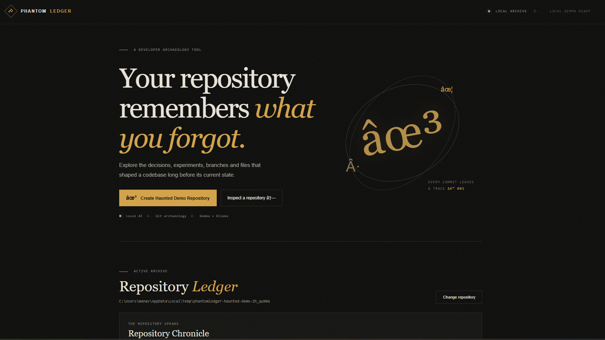

# PhantomLedger 👻

**Your repository remembers what you forgot.**

PhantomLedger is a local-first developer archaeology tool that reconstructs a repository’s memory from Git history, then lets a local Gemma model interpret a selected evidence bundle.

## Demo

[](https://drive.google.com/file/d/1H0uPjyoteWGSMLZP33JoZIDSP-cDcoWO/view?usp=sharing)

**[▶ Watch the full PhantomLedger demo](https://drive.google.com/file/d/1H0uPjyoteWGSMLZP33JoZIDSP-cDcoWO/view?usp=sharing)**

## What It Is

A Memory Ledger for the decisions, experiments, branches, files, and notes that shaped a codebase. The interface keeps verified Git facts visually separate from model interpretation.

## The Problem

The working tree only shows what survived. Reverted work, deleted modules, abandoned branches, repeated edits, and unresolved TODOs can hold useful context that is easy to lose.

## How It Works

1. Choose a repository or create the built-in synthetic demo.
2. PhantomLedger runs fixed, read-only Git commands and extracts commits, branches, file changes, authors, and dates.
3. Deterministic Python rules score and summarize historical memories.
4. Ask Gemma to interpret one selected memory. Only that memory's evidence is sent to Ollama.
5. Review facts and AI interpretation in separate sections. If Ollama is unavailable, the evidence remains usable without a fabricated answer.

**Git provides deterministic historical evidence. Gemma provides local interpretation.** The model does not calculate dates or commit relationships.

## Architecture

- **Backend:** Python 3.10+, FastAPI, Pydantic
- **Frontend:** Vanilla HTML, CSS, and JavaScript
- **Git:** Native Git CLI through explicit subprocess commands
- **AI:** Local Ollama API with configurable Gemma model
- **Storage:** In-memory analysis cache; the analyzed repository is not modified

## Memory Types

Deleted files, explicitly reverted changes, abandoned branches, long-lived TODO/FIXME markers, repeatedly modified files, short-lived experiments, and contributor inactivity.

Each memory includes a stable ID, interest score, dates, commits, files, authors, evidence, and a deterministic summary.

## Why Gemma

Gemma can turn a narrow evidence bundle into a concise historical explanation while running locally.

The prompt asks for known facts, unknowns, interpretation, and confidence as structured JSON; Pydantic validates the result. The application never treats generated prose as Git evidence.

## Why Open Innovation Matters

Open-weight AI lets developers inspect, run, and control the model locally. For code archaeology, that means private repository data can stay on the developer's machine, the tool can work without a cloud AI account, and users can choose their model.

This project sends no repository content to a cloud AI provider.

## Safety

- Analysis only accepts a directory containing `.git`.
- Git invocations are fixed by the application; no model output becomes a command.
- The analyzer does not checkout branches, write into the inspected repository, commit, push, pull, or delete user files.
- Ollama is contacted only after the user asks for interpretation, and only with the selected memory evidence.
- The demo generator writes only to a dedicated temporary demo directory.

## Installation

Requirements: Python 3.10+, Git, and optionally Ollama with a Gemma model available.

```powershell
python -m venv .venv
.\.venv\Scripts\Activate.ps1
pip install -r backend/requirements.txt